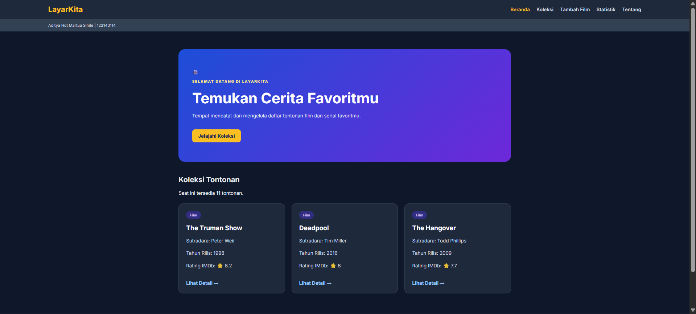

# LayarKita — Daftar Tontonan Film dan Serial

Nama: Aditya Hot Martua Sihite
NIM: 123140114
Kelas: RB
Tema: Daftar Tontonan Film dan Serial
Deployment: https://adityasihite.github.io/uts-paw/



LayarKita adalah aplikasi web untuk mencatat dan mengelola daftar film dan serial yang ingin atau sudah ditonton. Aplikasi ini dibuat untuk Ujian Tengah Semester IF25-22014 Pengembangan Aplikasi Web, Informatika ITERA, semester ganjil 2026/2027.

## Fitur

- **Beranda**: sambutan, jumlah total tontonan, dan tiga kartu koleksi pertama.
- **Koleksi**: daftar seluruh film dan serial dalam bentuk kartu, lengkap dengan pencarian berdasarkan judul.
- **Detail**: informasi lengkap satu tontonan (kategori, judul, sutradara, tahun rilis, rating IMDb) dan tombol **Hapus** dengan konfirmasi.
- **Tambah Film**: formulir dengan validasi (judul wajib, semua field terisi, tahun 1888–2100, rating 0–10) dan pesan error yang jelas.
- **Statistik**: tabel jumlah tontonan per kategori (Film / Serial).
- **Tentang**: identitas pembuat aplikasi.
- **Halaman 404** untuk rute yang tidak dikenal, dan pesan "Film Tidak Ditemukan" untuk id yang tidak ada.
- **Penyimpanan lokal**: 10 data awal dimuat dari `public/data/koleksi.json` melalui `fetch`, lalu film yang ditambah atau dihapus disimpan di `localStorage` sehingga tetap ada setelah halaman di-refresh.

## Menjalankan secara lokal

```bash
git clone https://github.com/AdityaSihite/uts-paw.git
cd uts-paw/app
npm install
npm run dev
```

Perintah lain (jalankan di folder `app/`):

```bash
npm run build   # build produksi
npm run lint    # periksa kode dengan oxlint
npm run test    # jalankan test Vitest
npm run cek     # perkiraan nilai rubrik
```

## Struktur folder

```
app/
├── public/data/koleksi.json   # 10 data awal
└── src/
    ├── components/            # Layout, Navbar, KartuFilm, BadgeRating, Pesan
    ├── context/               # KoleksiContext (state global + localStorage)
    ├── hooks/                 # useKoleksi, usePencarian
    ├── pages/                 # HalamanUtama (Beranda + Koleksi), DetailFilm,
    │                          # TambahFilm, Statistik, Tentang
    ├── App.jsx                # definisi rute
    └── main.jsx               # BrowserRouter + render
```

## Konsep React yang dipakai

- **Komponen dan props**: `KartuFilm`, `BadgeRating`, `Pesan`, `Layout`, dan `Navbar` dipakai ulang di beberapa halaman.
- **`useState` dan `useEffect`**: state formulir, state pencarian, serta pengambilan data awal saat aplikasi dimuat.
- **`useMemo`**: menyaring hasil pencarian hanya saat data atau kata kunci berubah.
- **Context API**: `createContext`, `KoleksiProvider`, dan `useContext` (lewat `useKoleksiContext`) untuk berbagi data koleksi di seluruh halaman.
- **Custom hook**: `useKoleksi` (fetch, gabung dengan `localStorage`, status loading dan error) dan `usePencarian` (logika pencarian judul).
- **React Router**: tujuh rute (`/`, `/koleksi`, `/koleksi/:id`, `/tambah`, `/statistik`, `/tentang`, `*`), `useParams`, `useNavigate`, serta `Link` dan `NavLink`.
- **Fetch dengan async/await**: dilengkapi state loading dan error yang ditampilkan lewat komponen `Pesan`.
- **Formulir terkontrol**: input terhubung ke state dan divalidasi sebelum disimpan.
- **Render daftar dan kondisional**: `map` dengan `key`, `filter`, `reduce` (statistik), serta tampilan berbeda untuk loading, error, dan data kosong.
- **HTML semantik**: `header`, `nav`, `main`, dan `footer`.
- **Pengujian**: Vitest dan Testing Library.

## Teknologi

React 19, React Router 7, Vite, Vitest, Testing Library, oxlint, dan GitHub Pages (deploy otomatis lewat GitHub Actions).
